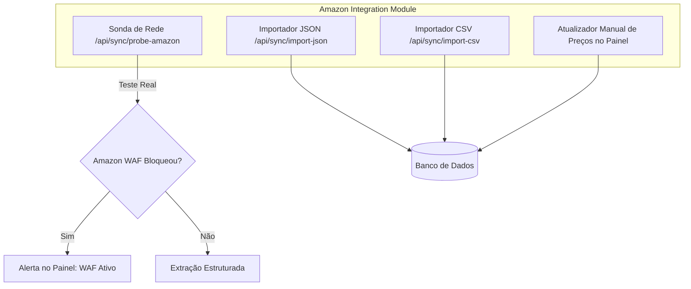

# Integração com a Amazon Brasil — Relatório Técnico e Operacional

## 1. Contexto e Fontes de Dados

O projeto consome produtos de duas listas reais criadas na Amazon Brasil:

1. **Lista de Presentes Principais — Talia:**  
   `https://www.amazon.com.br/baby-reg/taliavitria-nascimento-maro-2027-fortaleza/10NOCBS3PDNDW`
2. **Lista de Mimos Complementares — Lucas:**  
   `https://www.amazon.com.br/baby-reg/lucas-gabriel-maro-2027-fortaleza/24ZYPSUDF4A94`

---

## 2. Diagnóstico Técnico e Investigação de Acesso

Durante a fase de pesquisa e implementação, foram realizados testes aprofundados para avaliar a viabilidade de sincronização automática direta:

### 2.1 Análise de Web Scraping Direto
- **Comportamento Observado:** Requisições automatizadas HTTP enviadas para os endereços das listas da Amazon Brasil são interceptadas pela camada de segurança perimetral (AWS WAF / Cloudflare Bot Management).
- **Resposta da Amazon:** O servidor devolve desafio de CAPTCHA (*"Digite os caracteres que você vê"*) ou redireciona para a página de erro canônica com fotos de cães da Amazon (`https://images-na.ssl-images-amazon.com/images/G/32/error/`).
- **Conclusão:** Scraping puro e simples viola as políticas de acesso e termos de uso da Amazon, além de ser tecnicamente frágil e sujeito a falhas a qualquer momento.

### 2.2 Análise da Product Advertising API (PA-API 5.0)
- A PA-API da Amazon exige credenciais ativas do Programa de Associados (com pelo menos 3 vendas qualificadas nos últimos 180 dias).
- Além disso, a PA-API suporta operações de catálogo (`GetItems`, `SearchItems`), mas **não expõe métodos públicos para leitura de listas de bebê privadas ou de terceiros**.

---

## 3. Estratégia de Integração Implementada

Conforme exigido pelo item 3.2 dos requisitos de negócio, não foram simulados dados falsos nem endpoints fictícios. Foi desenvolvido um **módulo de integração modular e resiliente**:

### 3.1 Funcionalidades Entregues

1. **Sonda de Conectividade em Tempo Real (`POST /api/sync/probe-amazon`):**
   - Executa uma requisição legítima com cabeçalhos de navegador.
   - Analisa se o retorno contém bloqueio por CAPTCHA, WAF ou página de erro.
   - Retorna um diagnóstico transparente com o status code e a recomendação operacional.

2. **Importação Estruturada por Arquivo JSON e CSV:**
   - Permite aos pais importar planilhas ou arquivos JSON com ASIN, Nome, Preço, Descrição, Categoria, Quantidade Desejada e Links da Amazon.

3. **Atualização Manual Instantânea de Preços pelo Painel:**
   - No painel administrativo, o casal pode clicar em "Editar Preço" em qualquer presente ou mimo.
   - O sistema atualiza o `preco_atual`, preserva o `preco_anterior` e carimba a data e hora exata em `preco_sincronizado_em`.

4. **Congelamento Transacional de Preços na Reserva:**
   - O preço da Amazon é a referência no momento em que o convidado clica para reservar.
   - O valor é congelado em `preco_presente_reserva` e `preco_mimo_reserva`. Mesmo que o preço na Amazon suba ou desça depois, o valor da reserva confirmada permanece inalterado.
