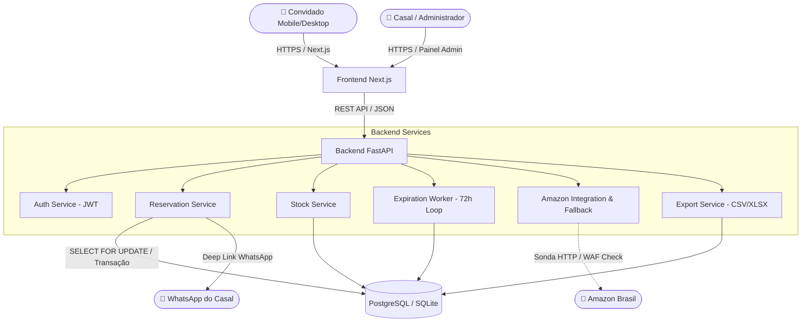

# Arquitetura do Sistema — Chá de Rifa do Lael

## 1. Visão Geral

O sistema **Chá de Rifa do Lael** foi desenvolvido com uma arquitetura moderna, desacoplada e orientada a serviços para suportar com extrema confiabilidade o evento real de chá de bebê previsto para março de 2027 em Fortaleza — CE.

A plataforma é dividida em três pilares principais:
1. **Frontend**: Aplicação Next.js (App Router) + React 19 + TypeScript + Tailwind CSS, responsiva, mobile-first e rica em microinterações visuais acolhedoras.
2. **Backend**: API REST de alto desempenho construída em Python com FastAPI, SQLAlchemy ORM, Pydantic V2 e tarefas agendadas em segundo plano (*background worker*).
3. **Camada de Dados e Persistência**: PostgreSQL 16 (ou SQLite com modo multithread seguro e chave estrangeira ativada para ambiente local), com transações e controle de concorrência com bloqueio a nível de linha.

---

## 2. Diagrama de Arquitetura

---

## 3. Modelo de Dados e Integridade Referencial

O modelo relacional foi desenhado para assegurar integridade máxima:

### 3.1 Entidades Principais

- **`administradores`**: Guarda credenciais com hash seguro `bcrypt` e status ativo.
- **`produtos_principais`**: Catálogo de presentes principais (Lista de Talia) com preço atual, preço anterior, data de última sincronização, quantidade desejada e quantidade comprada externa.
- **`mimos`**: Catálogo de mimos complementares (Lista de Lucas) com estoque controlado e tracking de disponibilidade.
- **`numeros`**: 100 números (01 a 100). Cada número possui chave estrangeira para o seu presente principal correspondente e um status público (`disponivel`, `reservado`, `confirmado`).
- **`reservas`**: Centraliza a intenção de participação do convidado:
  - `numero_id` (vínculo ao número).
  - `mimo_id` (vínculo ao mimo escolhido).
  - `nome_convidado` e `whatsapp` (higienizados e validados).
  - `forma_presente` (`amazon` ou `pix`).
  - `forma_mimo` (`amazon` ou `pix`).
  - `preco_presente_reserva` (preço congelado no momento da reserva).
  - `preco_mimo_reserva` (preço congelado no momento da reserva).
  - `valor_pix_total` (calculado estritamente sobre as escolhas em Pix).
  - `status` (`reservada`, `confirmada`, `expirada`, `cancelada`).
  - `expira_em` (data/hora limite de 72 horas).
- **`comprovantes`**: Rastreia individualmente os **dois** comprovantes obrigatórios:
  - Um registro para `tipo_item='presente'`.
  - Um registro para `tipo_item='mimo'`.
  - Status individual: `aguardando_envio`, `recebido`, `aprovado`, `rejeitado`.
  - **Regra de ouro**: Uma reserva só pode transitar para `confirmada` quando **AMBOS** os comprovantes estiverem marcados como `aprovado`.
- **`historico_administrativo`**: Log de auditoria contendo registro imutável de todas as ações de criação, alteração de status de comprovantes, confirmação, liberação, extensão de prazo e alterações de preços.
- **`configuracoes`**: Tabela chave-valor para armazenamento dinâmico de dados bancários do Pix, WhatsApp do casal, textos institucionais e prazos sem dependência de recompilação de código.

---

## 4. Concorrência e Transacionalidade

Para evitar overbooking ou reservas duplicadas no mesmo número ou mimo:
1. Ao receber a requisição de reserva, o backend inicia uma transação no banco de dados.
2. Em PostgreSQL, a consulta do número executa `with_for_update()`, bloqueando o registro até o `commit`.
3. É validado se o número está estritamente com `status == 'disponivel'`.
4. O estoque restante do mimo é calculado em tempo real:
   $$\text{Disponibilidade} = \max(0, \text{Desejada} - \text{CompradaExterna} - \text{ReservadasAtivas} - \text{Confirmadas})$$
5. Se o mimo estiver esgotado, a transação sofre `rollback` e retorna `409 Conflict`.
6. Se bem-sucedida, o número transita atomicamente para `reservado`, os 2 comprovantes são inseridos e o `commit` libera o bloqueio.

---

## 5. Expiração Automática (72 Horas)

O backend possui uma tarefa assíncrona (`start_expiration_worker`) executada a cada 60 segundos:
- Consulta todas as reservas com `status == 'reservada'` cuja data `expira_em < datetime.utcnow()`.
- Marca a reserva como `expirada`.
- Retorna o número para o status `disponivel`.
- Libera o estoque comprometido do mimo.
- Grava o evento na tabela de auditoria.
