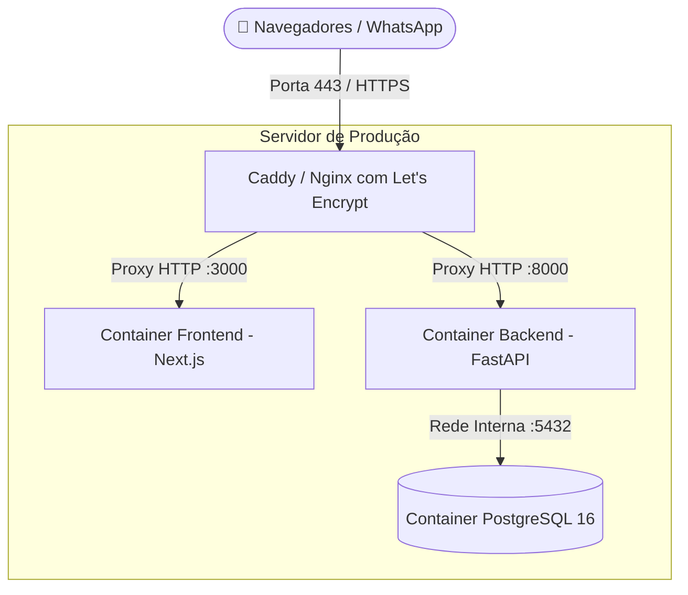

# Guia de Publicação e Deploy em Produção

Este guia detalha o processo completo para implantar o **Chá de Rifa do Lael** em um ambiente de produção seguro, com HTTPS, banco de dados PostgreSQL e rotinas de backup automatizadas.

---

## 1. Topologia de Produção

A arquitetura recomendada para publicação em servidor VPS (Ubuntu 22.04 / 24.04 LTS):



---

## 2. Preparação do Servidor (VPS)

Em uma máquina limpa com Ubuntu:

```bash
# Atualização de pacotes
sudo apt update && sudo apt upgrade -y

# Instalação do Docker e Docker Compose
sudo apt install -y curl git ufw
curl -fsSL https://get.docker.com | sh
sudo usermod -aG docker $USER

# Configuração básica de Firewall
sudo ufw default deny incoming
sudo ufw default allow outgoing
sudo ufw allow ssh
sudo ufw allow http
sudo ufw allow https
sudo ufw enable
```

---

## 3. Configuração de Variáveis de Ambiente

Crie o arquivo `.env` na raiz do projeto:

```bash
# Gere uma chave secreta forte com openssl:
# openssl rand -hex 32
SECRET_KEY="SUA_CHAVE_SECRETA_GERADA_AQUI"

# Banco de dados de produção
POSTGRES_USER=lael_admin
POSTGRES_PASSWORD=GERAR_SENHA_FORTE_AQUI
POSTGRES_DB=cha_de_rifa_prod

DATABASE_URL=postgresql+psycopg2://lael_admin:GERAR_SENHA_FORTE_AQUI@db:5432/cha_de_rifa_prod

# Configurações do evento
DEFAULT_RESERVATION_HOURS=72
TOTAL_NUMBERS=100
EXPIRATION_WORKER_INTERVAL=60

# URL pública da API consumida pelo frontend
NEXT_PUBLIC_API_URL=https://seudominio.com.br/api
```

---

## 4. Configuração de HTTPS com Caddy (Recomendado)

O Caddy gerencia certificados SSL/TLS automaticamente com Let's Encrypt. Crie um arquivo `Caddyfile`:

```caddy
seudominio.com.br {
    # Redireciona chamadas /api/* para o container backend
    handle /api/* {
        reverse_proxy backend:8000
    }

    # Redireciona a documentação interativa da API
    handle /docs* {
        reverse_proxy backend:8000
    }
    handle /redoc* {
        reverse_proxy backend:8000
    }
    handle /openapi.json {
        reverse_proxy backend:8000
    }

    # Demais rotas vão para o Next.js
    handle {
        reverse_proxy frontend:3000
    }

    encode gzip zstd
}
```

---

## 5. Rotina de Backup e Restauração

### 5.1 Script de Backup Diário Automático

Crie o script `scripts/backup.sh`:

```bash
#!/bin/bash
BACKUP_DIR="/var/backups/rifa_lael"
TIMESTAMP=$(date +"%Y%m%d_%H%M%S")
mkdir -p "$BACKUP_DIR"

# Executa dump do banco PostgreSQL diretamente pelo container
docker exec -t rifa_lael_db pg_dump -U lael_admin cha_de_rifa_prod | gzip > "$BACKUP_DIR/backup_$TIMESTAMP.sql.gz"

# Mantém apenas os backups dos últimos 30 dias
find "$BACKUP_DIR" -type f -name "*.sql.gz" -mtime +30 -delete

echo "[BACKUP] Backup gerado com sucesso em $BACKUP_DIR/backup_$TIMESTAMP.sql.gz"
```

Configure no Cron (`crontab -e`):

```cron
# Executar backup diário às 03:00 da manhã
0 3 * * * /bin/bash /caminho/do/projeto/scripts/backup.sh >> /var/log/backup_rifa.log 2>&1
```

### 5.2 Como Restaurar um Backup

Caso precise restaurar o banco de dados em um novo servidor:

```bash
gunzip -c /var/backups/rifa_lael/backup_20261104.sql.gz | docker exec -i rifa_lael_db psql -U lael_admin -d cha_de_rifa_prod
```
